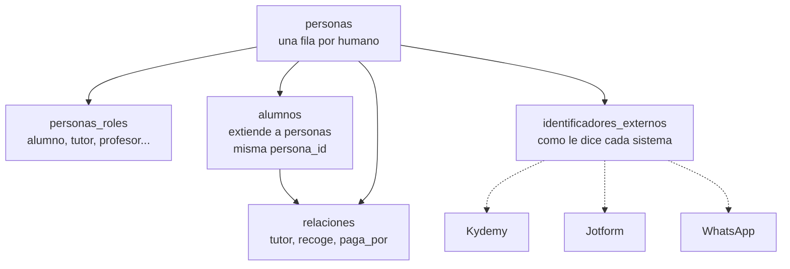

> [!warning] Nota generada
> La escribe `lisart vault` desde `src/lisart/tables.py`. Si la editas a mano, se pierde en la siguiente corrida.

# Identidad

**Una persona es una persona.** Un profesor que ademas es tutor de su hija es
UNA fila en [[personas]] con dos roles en [[personas_roles]], no dos personas.

Duplicar humanos es la causa raiz de casi todo lo que se rompe despues: pagos
que no cuadran, mensajes enviados dos veces, un alumno inscrito y prospecto al
mismo tiempo.

## Como se conectan las piezas

## Los dos casos que obligaron a este diseño

**"Sofi paga por mi".** Quien paga no siempre es el alumno. Por eso
[[relaciones]] tiene el tipo `paga_por`: sin eso, cualquier cruce de pagos
ingenuo falla.

**El mismo humano con tres nombres.** [[Jotform]] dice "Ma. José Hernández",
[[Kydemy]] dice "MARIA JOSE HERNANDEZ" y [[WhatsApp]] solo trae un telefono.
Por eso existe [[identificadores_externos]]: el cruce se hace por identificador,
no por nombre. Cruzar por nombre es el ultimo recurso, no el primero.

Para eso sirven `ids.normalizar_nombre` (quita acentos, respeta la ñ) y
`ids.normalizar_telefono` (deja E.164, que es lo que entiende WhatsApp).

Volver a [[Lisart]].
