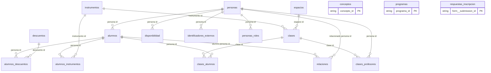

> [!warning] Nota generada
> La escribe `lisart vault` desde `src/lisart/tables.py`. Si la editas a mano, se pierde en la siguiente corrida.

# Lisart

Sistema administrativo de la escuela de musica Lisart. Esta nota es la
puerta de entrada; abre la **vista de grafo** de Obsidian para ver todo junto.

> [!tip] Como leer el grafo
> Los circulos **huecos** son notas que no existen todavia. Como los
> proyectos ya enlazan a tablas que faltan (`[[pagos]]`, `[[envios]]`,
> `[[clases]]`), esos huecos son el mapa de lo que falta construir.

## El modelo de datos

## Tablas

**Se editan a mano:**

- [[conceptos]] — Que se cobra y cuanto. Los montos se versionan por vigencia en vez de sobrescribirse, para...
- [[espacios]] — Todos los espacios fisicos de la escuela, no solo las aulas: tambien recepcion, cocina y b...
- [[instrumentos]] — Instrumentos que se ensenan. Los nombres deben coincidir con los del formulario de inscrip...
- [[alumnos_descuentos]] — Que descuento tiene cada alumno. **Es la unica tabla del sistema que se llena a mano abrie...

**Las escribe el codigo:**

- [[descuentos]] — Descuentos que la escuela reconoce. Sale del mismo Excel. **Todavia no se sabe quien tiene...
- [[personas]] — Una fila por ser humano relacionado con la escuela, sin importar su rol. Alumnos, tutores,...
- [[programas]] — Los programas de aprendizaje y su precio mensual. Sale del Excel `data/catalogos_lisart.xl...
- [[respuestas_inscripcion]] — Una fila por envio del formulario de inscripcion de Jotform, ya aplanado a columnas. Vive ...
- [[alumnos]] — Datos que solo tienen sentido para un alumno. Es una extension de `personas`: la llave es ...
- [[clases]] — Una clase en la semana tipo: que dia, a que hora, en que espacio. Quien la da y quien la t...
- [[disponibilidad]] — Cuando puede cada persona, semana tipo. Vale para profesores y para alumnos: el alumno dec...
- [[identificadores_externos]] — Puente entre nuestra persona_id y como la llama cada sistema de afuera. Es la pieza que pe...
- [[personas_roles]] — Que papel juega cada persona. Una persona puede tener varios roles a la vez y puede cambia...
- [[alumnos_instrumentos]] — Que instrumento estudia cada alumno. Es de muchos a muchos: hay quien lleva dos. Separarla...
- [[clases_alumnos]] — Quien toma cada clase....
- [[clases_profesores]] — Quien da cada clase. Es de muchos a muchos a proposito: una clase puede tener mas de un pr...
- [[relaciones]] — Vinculos entre personas. Cubre el tutor legal, el contacto de emergencia, quien puede reco...

## Los cuatro proyectos

- [[Proyecto 1 - Mensajes automaticos]]
- [[Proyecto 2 - Segmentacion de alumnos]]
- [[Proyecto 3 - Centralizacion de pagos]]
- [[Proyecto 4 - Calendarizacion]]

## De donde salen los datos

- [[Jotform]] · [[Kydemy]] · [[WhatsApp]]

## Documentos que se manejan

- [[Formulario de inscripcion]]
- [[Politicas y reglamento]]
- [[Proyeccion de pago]]
- [[Comprobante de pago]]
- [[Documento de reembolso]]

## Como funciona por dentro

- [[Modelo de datos]] — las capas y las reglas
- [[Identidad]] — por que una persona es una sola fila
