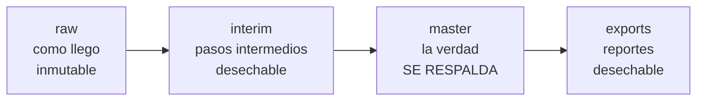

> [!warning] Nota generada
> La escribe `lisart vault` desde `src/lisart/tables.py`. Si la editas a mano, se pierde en la siguiente corrida.

# Modelo de datos

La base de datos son **archivos CSV**. Es una decision consciente: a escala de
cientos de personas, un CSV disciplinado se abre en Excel, se respalda copiando
una carpeta y no cobra renta. Lo que un CSV no trae de fabrica —tipos, llaves,
integridad— lo pone el paquete `lisart`.

## Las cuatro capas

El flujo **nunca** va al reves. Si se borra `interim/` y `exports/`, se
reconstruyen. Si se borra `master/`, se perdio informacion.

Aparte de las cuatro capas esta `data/backups/`, que no es parte del flujo sino
una red de seguridad: cada vez que se guarda desde la pantalla ([[Pantalla]]),
el estado anterior queda ahi.

Entran por [[Jotform]], [[Kydemy]] y [[WhatsApp]]; salen como
[[Proyeccion de pago]] y [[Comprobante de pago]].

## Quien escribe cada tabla

| Tipo | Quien | Codificacion |
| --- | --- | --- |
| `managed` | Solo el codigo | UTF-8 |
| `hand_edited` | Una persona, en Excel | UTF-8 con BOM |

El BOM es lo que evita que Excel en español muestre `María`.

## La regla innegociable

Nunca `pd.read_csv` ni `df.to_csv` sobre `data/`. Todo pasa por `read_table`,
`write_table` y `upsert`, que es donde viven los tipos, la validacion y la
escritura atomica.

Detalle completo en `docs/convenciones_datos.md`. Volver a [[Lisart]].
